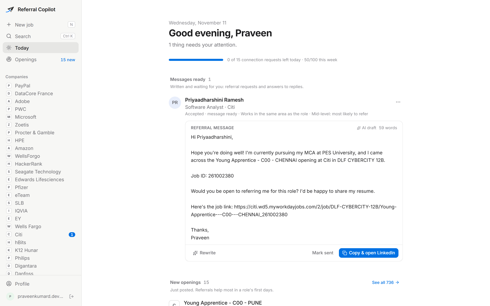
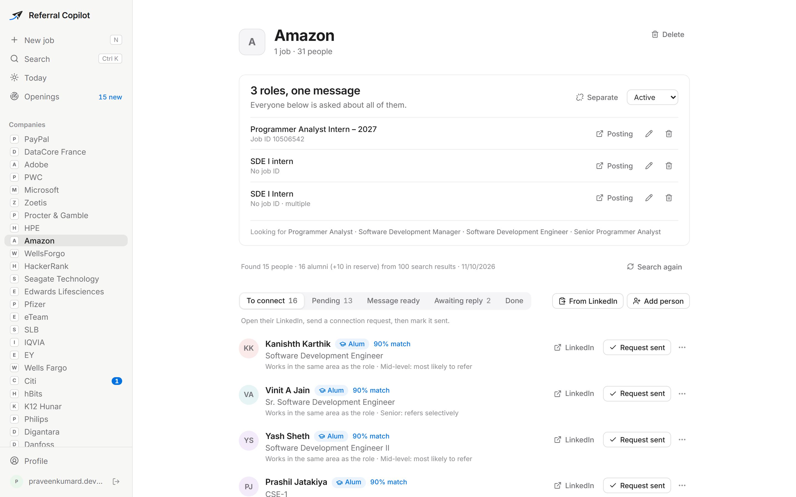
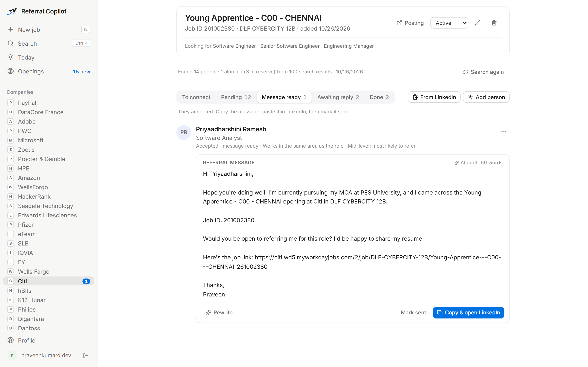
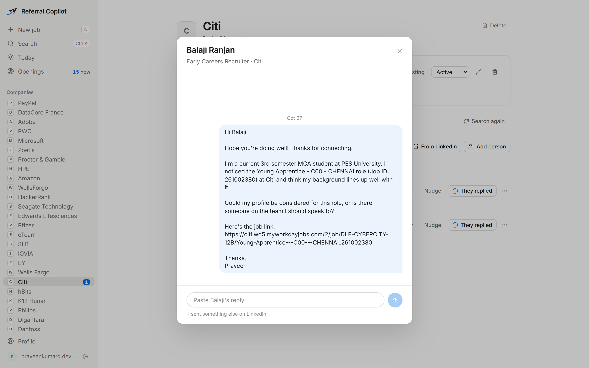
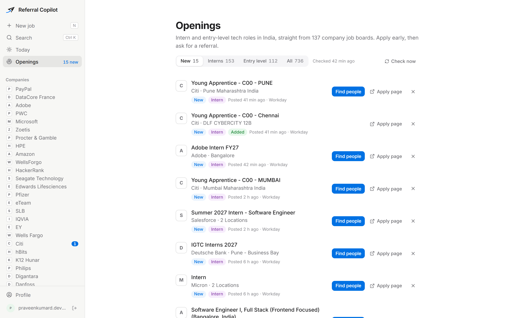
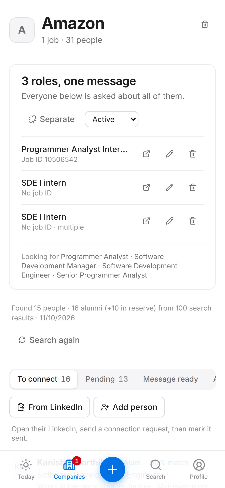

<p align="center">
  
</p>

<h1 align="center">Referral Copilot</h1>

<p align="center">
  A personal referral CRM for a student job hunt.<br />
  Paste a job, get the ~15 employees most likely to refer you (alumni first), send a message that sounds like you, and track every person until the referral lands.
</p>

<p align="center">
  <a href="https://referral-copilot.onrender.com"><b>Live app</b></a> ·
  <a href="#features">Features</a> ·
  <a href="#how-it-works">How it works</a> ·
  <a href="#getting-started">Getting started</a> ·
  <a href="docs/">Docs</a>
</p>



---

## Why

Referrals are the channel that actually turns into interviews for students, but the work around them is tedious: finding the right people at a company, spotting alumni, writing a message that doesn't read like AI, and remembering who accepted, who replied and who went quiet.

Referral Copilot does the research, ranking, drafting and tracking. **Every LinkedIn action stays manual**: you click Connect and Send yourself. The app never touches linkedin.com.

## Features

### Find the right people
- **Discovery in about a minute.** Plain Google search (via Serper) finds candidates; every one must be backed by a real search result that shows the company as their current employer. Former employees and look-alike companies (HP vs HPE) are rejected.
- **Alumni first.** Your college is matched across spellings (PES University, PESU, PESIT…); alumni get the biggest weight in the ranking.
- **Ranking based on who actually refers freshers.** Mid-level and early-career engineers near the team rank highest; directors, interns and unrelated functions rank low; recruiters are capped and labelled "can't refer, but can route you". Every score explains itself.
- **Paste from LinkedIn.** Copy a company's People page (optionally filtered by your college) and paste it in. The AI only extracts; every name must appear word for word in what you pasted.



### Messages that sound like you
- **AI-written drafts from verified facts only**: your degree, semester, fit line and matching skills, the role, the company's real job ID and the link.
- **Checked in code, not just in the prompt**: no em dashes, no stock AI phrases ("I hope this message finds you well", "strong fit"), no invented coursework, no implied shared college for non-alumni, and never LinkedIn's posting number passed off as a job ID. One corrective retry, then a template fallback.
- **Rewrite** shorter, warmer, more formal, or try another version.
- **Combine roles**: ask one person about up to three openings at the same company in one message, each with its own job ID and link.



### Track every conversation
- **Pipeline tabs**: To connect → Pending → Message ready → Awaiting reply → Done, with one-click status changes, instant (optimistic) updates and Undo instead of confirmation dialogs.
- **Per-person chat**: paste their reply; the AI reads it, suggests the next status and drafts your answer in the thread.
- **Today** shows only what needs you: messages written and waiting to be sent, plus old invites worth closing. A daily/weekly invite budget (15 / 100) keeps you clear of LinkedIn's limits.
- **Ctrl+K search** to find anyone across all jobs, e.g. right after an "accepted your invitation" notification.



### Catch openings early
- **Openings** reads public job feeds (Greenhouse, Lever, Ashby, SmartRecruiters, Workday, amazon.jobs and a curated freshers list) for 100+ companies and shows new intern and entry-level tech roles in India, usually before they reach LinkedIn.
- **One click from opening to people**: "Find people" creates the job and starts discovery.
- Scans run when you open the app and every 2 hours through an outside cron, with no background worker.



### Works on your phone
Bottom tab bar, bottom sheets, safe areas and 16px inputs; installable as a home-screen app.

<p align="center">
  
</p>

## How it works

```
Browser ──▶ Next.js :3000 (UI) ──/api/* rewrite──▶ Express :4000 ──▶ Neon Postgres
                                                     ├──▶ Gemini (fallback Groq, then rules/templates)
                                                     ├──▶ Serper (Google results)
                                                     └──▶ Public job feeds
```

**Discovery pipeline**

```
analyze job ─▶ plan queries ─▶ search ─▶ verify ─▶ classify ─▶ score ─▶ top 15 + 10 reserves
   (AI)        (alumni-heavy)  (Serper)  (code)     (AI)       (code)
```

**Design choices**
- **Deterministic workflow, LLM only inside specific steps.** A pure state machine (`packages/core`) is the single source of truth for pipeline state; the browser runs the same function for optimistic updates. The LLM never decides state.
- **Verify, don't trust.** No person, school or job detail reaches a message unless it came from a real source.
- **Every AI task is structured.** JSON schema → Zod validation → one repair retry → next provider. Every attempt is logged.
- **Built for free tiers.** One Render service runs both processes; no queue, no polling worker (reminders are computed from timestamps on read), batched writes for Neon's ~150 ms round trips.

The reasoning behind each decision is in [`docs/DECISIONS.md`](docs/DECISIONS.md).

## Tech stack

| Layer | Tools |
|---|---|
| Web | Next.js 16 (App Router), React 19, Tailwind CSS 4, TanStack Query, Motion |
| API | Express 5, Better Auth (Google sign-in), Zod |
| Database | PostgreSQL on Neon, Prisma 7 (`@prisma/adapter-pg`) |
| AI | Gemini (primary, per-model quota fallback), Groq (fallback) |
| Search | Serper (Google results) |
| Tooling | pnpm monorepo, TypeScript everywhere, Vitest |
| Hosting | Render (web + API in one service), cron-job.org for scans |

## Repository layout

| Path | Contents |
|---|---|
| [`apps/web`](apps/web) | The UI. The browser only talks to `:3000`; Next rewrites `/api/*` to Express |
| [`apps/api`](apps/api) | Express routes (`src/routes/v1.ts`), services (discovery, messages, outreach, openings, feeds…) |
| [`packages/core`](packages/core) | Pure, unit-tested domain logic: state machine, discovery (plan, verify, score), message templates and validator, job-feed filters |
| [`packages/ai`](packages/ai) | LLM provider abstraction, `runTask`, versioned prompts |
| [`packages/db`](packages/db) | Prisma schema and migrations |
| [`docs`](docs) | Architecture, API map, decisions, research, roadmap |

## Getting started

**Requirements:** Node 22, pnpm 12, a PostgreSQL database (Neon works), a Google OAuth client. Gemini/Groq and Serper keys are optional: without AI the app falls back to rules and templates, and without Serper it asks you to add a key or paste from LinkedIn.

```bash
pnpm install
cp .env.example .env        # fill in the values (see below)
pnpm db:generate
pnpm db:migrate
npm run dev                 # API on :4000, web on :3000
```

Open http://localhost:3000, sign in with Google, fill in your profile (college and degree power alumni matching and messages), then add a job. On an empty account you can also load fictional sample data to explore.

### Environment

All variables live in one `.env` at the repo root. See [`.env.example`](.env.example).

| Variable | Purpose |
|---|---|
| `DATABASE_URL` / `DIRECT_URL` | Pooled URL for the app, direct URL for migrations |
| `BETTER_AUTH_SECRET`, `BETTER_AUTH_URL` | Session signing (32+ chars) and the web app's public origin |
| `GOOGLE_CLIENT_ID`, `GOOGLE_CLIENT_SECRET` | Google sign-in; redirect URI `<BETTER_AUTH_URL>/api/auth/callback/google` |
| `GEMINI_API_KEY`, `GROQ_API_KEY` | AI providers (optional) |
| `SERPER_API_KEY` | People search (optional; free plan has 2,500 searches) |
| `CRON_SECRET` | Optional; enables `/api/cron/openings` for scans while the app is closed |

### Commands

| Task | Command |
|---|---|
| Run web + API | `npm run dev` |
| Unit tests | `pnpm test` |
| Typecheck | `pnpm typecheck` |
| Lint (web) | `pnpm --filter @rc/web lint` |
| Migrations | `pnpm db:migrate` |

More detail, including deployment and safe migrations, is in [`docs/DEVELOPMENT.md`](docs/DEVELOPMENT.md).

## LinkedIn and job-site boundaries

- No requests to linkedin.com and no automation of any kind (scraping, clicking, sending), as LinkedIn's User Agreement forbids it. The app only opens profile links in your own browser tab and reads text you paste.
- Job feeds come only from public, unauthenticated endpoints. No logins, no bot-check bypasses, and no sites whose terms forbid crawling.
- Job boards are only taken from real links, never guessed from company names.

## Documentation

| Doc | What's in it |
|---|---|
| [`ARCHITECTURE.md`](docs/ARCHITECTURE.md) | Components, data model, key flows |
| [`API.md`](docs/API.md) | Every route and page |
| [`DECISIONS.md`](docs/DECISIONS.md) | Why things are the way they are |
| [`DEVELOPMENT.md`](docs/DEVELOPMENT.md) | Setup, env vars, deployment, migrations |
| [`ROADMAP.md`](docs/ROADMAP.md) | Ideas not built yet, with the research behind them |
| [`research/`](docs/research/) | Who refers freshers, message rules, platform limits, Indian intern hiring |
